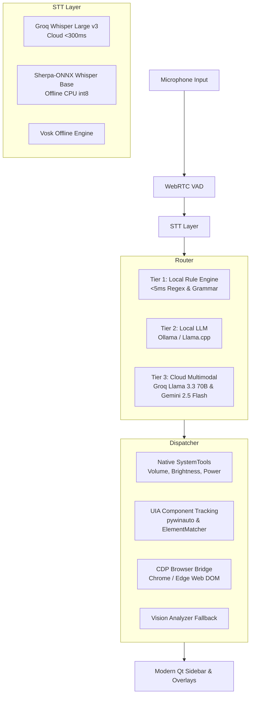

# Vyoma Handless™ — Desktop AI Copilot

<p align="center">
  
</p>

<p align="center">
  <strong>Your desktop, without hands.</strong><br>
  <em>Natural voice control, real-time visual grounding, speculative dictation, and native hardware automation for Windows 11.</em>
</p>

<p align="center">
  
  
  
  
  
  
  
</p>

---

## 🌟 Overview

**Vyoma Handless** is an intelligent, voice-first desktop copilot engineered specifically for Windows 11. It bridges natural speech, computer vision, Windows UI Automation (pywinauto/UIA), and Chrome DevTools Protocol (CDP) to give you total hands-free control over your PC.

Whether you're dictating emails at lightning speed, navigating complex web applications, managing browser tabs, adjusting hardware controls (volume, brightness, power), or automating multi-step daily workflows, Handless turns spoken words into instantaneous desktop actions.

---

## ✨ Core Features

### ⚡ 1. Wispr Flow Speculative Streaming Dictation
* **Sub-100ms Perceived Latency**: Streams sliding 200ms audio chunks to Groq Whisper Large v3 in parallel background threads while you are still speaking. By the time you release the push-to-talk key, 90%+ of your sentence is already transcribed.
* **4-Level Auto Cleanup Engine**:
  * **Level 0 (Raw)**: Verbatim speech with natural punctuation.
  * **Level 1 (Light)**: Removes hesitation fillers (`um`, `uh`, `like`, `you know`).
  * **Level 2 (Medium)**: Fixes false starts, grammar stutters, and speech disfluencies.
  * **Level 3 (Studio)**: Polished, professional prose formatted with high stylistic coherence.
* **Rate-Limit Aware**: Intelligent sliding RPM budget tracking ensures quota protection and zero dropped utterances.

### 🎨 2. Modern Copilot Sidebar & Floating Action Widget
* **Cream & Paper Minimal Aesthetic**: Clean, editorial aesthetic inspired by modern productivity tools (high-DPI SVG vector icons, warm gradients, elegant typography).
* **Sidebar Mobility & Flexibility**:
  * Dock left or dock right dynamically (`"dock sidebar left"`, `"dock right"`).
  * Toggle between standard (400px) and wide studio (560px) layout modes (`"wide mode"`, `"compact mode"`).
* **Floating Square Action Widget**: Smoothly docks along your screen edge when the sidebar is minimized. Features an animated breathing bot character with glowing aura and click-to-expand transitions.

### 🔍 3. Screen Lens (`Win + Shift + Space`)
* Universal visual screen query and instant answer overlay.
* Captures the active window or entire screen and leverages **Google Gemini 2.5 Flash** / **Groq Llama 3.3 70B** for instant visual grounding, OCR translation, code snippet explanation, and UI question answering.

### 🔊 4. Native Hardware & System Tools Engine
* Direct hardware control via native Windows multimedia COM APIs and WMI/CIM brightness controllers:
  * Master volume: `"set volume to 80"`, `"turn volume up"`, `"mute"`, `"max volume"`.
  * Display brightness: `"set brightness to 70%"`, `"dim screen"`, `"brightness up"`.
  * Power actions: `"lock my pc"`, `"sleep pc"`, `"restart computer"`, `"shut down"`.
  * Window management: `"snap left"`, `"snap right"`, `"maximize"`, `"show desktop"`.
  * Night light and dark mode toggling.

### 🌐 5. True Web DOM Piercing & Browser Tracking
* **Chromium Accessibility Bridge**: Injects native accessibility handshakes into Chrome, Edge, and Brave so web elements inside `Chrome_RenderWidgetHostHWND` are exposed as accessible native nodes.
* **CDP High-Speed Bridge**: Directly connects to Chrome/Edge debugging ports (`localhost:9222`) to pull exact DOM attributes (id, CSS selectors, XPath, ARIA labels, viewport scroll coordinates) with zero UIA latency.
* **Smart Messaging Flow**: Context-aware distinction between search inputs, contact list items, and conversation inputs in web apps like WhatsApp, Discord, Slack, and Teams.

### 🎯 6. Desktop Element Inspector & Crosshair Spy Tool
* **Live Hover Element Snapper**: Move your mouse across any app or web page to see a glowing bounding box snap directly around the element under the cursor in real time.
* **Dynamic-First, Coordinate-Fallback**: Generates 3-tier resilient locators (Primary AutomationId/Name, Secondary Structural Hierarchy, Tertiary Vision/Coordinate fallback).

### 🎙️ 7. Gemini Multimodal Live Voice Call
* Bidirectional real-time voice call powered by the Gemini Live API.
* Pulsing 3D geometric thinking orb that morphs dynamically with speaking states, audio waveforms, and AI tool execution.

### 📜 8. Multi-Sector History Journal
* Logs and categorizes actions across **System**, **Apps**, **Web**, **Dictation**, **Files**, and **Automation**.
* 1-click **Undo Dictation** to instantly restore previous clipboard and document states.

---

## 🏛️ System Architecture



---

## 🚀 Quick Start

### Prerequisites
* Windows 11 or Windows 10 (64-bit)
* Python 3.11 or 3.12
* Working microphone

### Installation

1. **Clone the repository:**
   ```powershell
   git clone https://github.com/vyoma-innovations/handless.git
   cd handless
   ```

2. **Create and activate a virtual environment:**
   ```powershell
   python -m venv .venv
   .\.venv\Scripts\activate
   ```

3. **Install dependencies:**
   ```powershell
   pip install -e ".[dev]"
   ```

4. **Configure API Keys (Optional but Recommended):**
   * *Groq API Key* (for Whisper Large v3 & ultra-fast Llama 3.3):
     Configure in the in-app Settings panel or set in your environment:
     ```powershell
     $env:GROQ_API_KEY="gsk_..."
     ```
   * *Google Gemini API Key* (for Gemini 2.5 Flash Vision & Live Call):
     ```powershell
     $env:GEMINI_API_KEY="AIza..."
     ```
   *(Keys can also be securely stored in Windows Credential Manager via the Settings UI)*

5. **Launch Handless:**
   ```powershell
   .\run.bat
   # or
   python -m handless.app
   ```

---

## ⌨️ Default Hotkeys

| Hotkey | Action |
|---|---|
| `F8` *(Hold)* | **Wispr Flow Push-to-Talk Dictation** (Speculative pre-transcription) |
| `Ctrl + Space` | **Toggle Handless Voice Bar / Modern Sidebar** |
| `Win + Shift + Space` | **Screen Lens** (Universal visual screen QA) |
| `Ctrl + Shift + Q` *(or double `Esc`)* | **Emergency Stop** (Instantly abort in-flight actions) |
| `Ctrl + Shift + I` | **Desktop Element Inspector & Spy Tool** |

---

## 🗣️ Example Voice Commands

| Category | Example Command |
|---|---|
| **System & Hardware** | *"Set my PC brightness to 80%"*, *"Turn volume up"*, *"Mute audio"*, *"Lock my PC"* |
| **Window Layout** | *"Snap left"*, *"Snap right"*, *"Maximize window"*, *"Show desktop"* |
| **Browser & Web** | *"Open YouTube and search lo-fi hip hop"*, *"Switch to tab 2"*, *"Close tab"* |
| **Messaging & Chat** | *"Select Vaishu and type hi to her"*, *"Send hello to Alex"* |
| **Automation & Macros** | *"Start macro recording"*, *"Save workflow as Daily Standup"*, *"Run Focus Mode"* |
| **Visual Query** | *"Screen lens"*, *"Explain what is on my screen"*, *"Summarize this article"* |

---

## 🧪 Running Tests

Handless includes a comprehensive test suite covering UIA tracking, system tools, regex grammar, rate limiting, and speculative dictation:

```powershell
pytest -q
# Output: 304 passed in ~55s
```

---

## 📄 License

This project is licensed under the **MIT License** — see the [LICENSE](LICENSE) file for details.

---

<p align="center">
  Built with ❤️ by <strong>Vyoma Innovations</strong>
</p>
